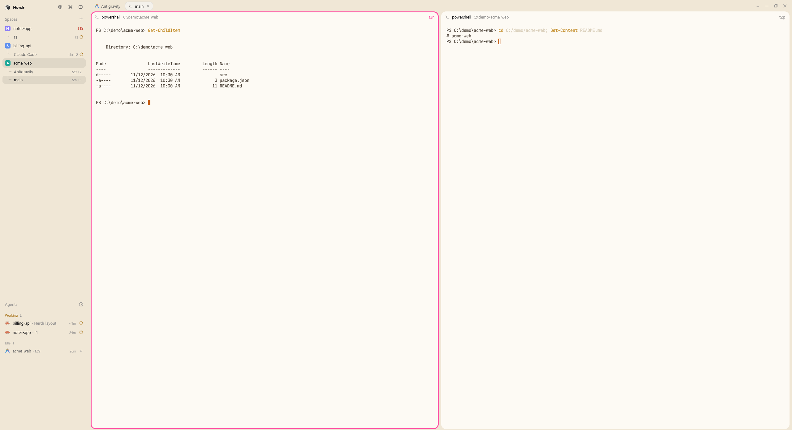

# Seamless

A borderless, cozy layout for [Herdr](https://herdr.dev). It starts from the default `main` layout and removes the lines, the title bar and the status bar, so the sidebar, tab strip and panes sit on soft cream and sand surfaces with rounded pane cards.

## What's different from the default layout

### Look

- **No title bar, no dividers.** Every divider and pane border in the default layout is gone, including the lines under the tab strip, above the Agents list and above the sidebar footer.
- **No status bar.** The bottom bar is removed.
- **Rounded pane cards.** Panes are cards with a 16px radius on a sand background, with an 8px gap between them. A transparent 3px border keeps panes from shifting when focus moves.
- **Pink focus ring.** The focused pane gets a 3px pink (`#ff4fa3`) ring.
- **Cozy light theme.** A bundled `cozy-paper` theme: cream sidebar and bars (`#f0e7d6`), sand gaps (`#e5d9c4`), white pane cards, warm terminal colors. Dark mode uses the shipped `graphite` theme, unchanged.
- **Square-fill fix.** `terminal_opacity: 0` stops the terminal's square fill poking out past the rounded card corners.
- **One text size.** Sidebar headings, tab pills, pane headers and panel buttons are all 13px.

### Sidebar

- **Tabs under each space.** Spaces list their tabs as a tree with elbow connectors. Clicking a tab selects its space, then the tab, and shows its status (spinner or dot). Each tab row shows the first terminal address, with "+N" when there are more.
- **One block when it's alone.** When a space's first tab is the active one, the space row and the tab row share one color and squared touching corners, so a space with one tab reads as a single rounded block.
- **Header buttons.** Settings (gear), Command palette (opens `app.palette`) and the sidebar toggle sit in the header. The search button and the Settings and Add machine rows at the bottom are gone, so the footer is empty. An update-ready dot moves to the gear.

### Tabs

- **Automatic names.** A tab nobody named shows the agent's name, else the folder it is in, else the program name, else "Terminal". Display only; the tab itself stays unnamed.
- **Quieter pills.** Inactive pills and the Files and Changes buttons are transparent. Only the active pill has a border and fill.

### Pane header

- **Terminal address.** The id that `hc send` accepts (for example `t1x`) shows at the far right of each pane header, pink on the focused pane. The split, zoom and close buttons still appear on hover, to its right.
- **Flat header.** No header fill or bottom border, so the card's top corners stay round.

## Install

Copy the folders into `~/.config/herdr-app/` (`layouts/`, `mods/`, `themes/`), then switch layouts with `layout.switch {"name":"seamless"}` (or `ctrl-shift-l` to switch back). Your own layout stays as it was; deleting the files removes this one. The folder layout and the mods are described in [RECIPE.md](RECIPE.md).

## Things to know

- The pink `#ff4fa3` is hard-coded in the layout and in the `seamless-pane` mod, not a theme color.
- The collapsed sidebar rail hides the header buttons, so Settings is reachable only from the expanded sidebar.
- Layout color overrides apply to both light and dark. That is why the light colors live in a theme file, paired with `graphite` for dark.
- Don't save the layout or theme with a byte-order mark; Herdr silently rejects a layout that has one.
- The mods are clones of Herdr's shipped `tabs`, `spaces`, `agents`, `workspace-chrome` and `pane` mods (version 0.1.15). They won't pick up later changes to the originals.
- The Files and Changes side panel uses the shipped `files` and `changes` mods and is hidden by default.
- Only the light theme has been looked at on screen while building this; dark mode was seen once, on an earlier version.

## Files

| Path | What it is |
|---|---|
| `layouts/seamless.json` | the layout (a changed copy of `main`) |
| `themes/cozy-paper.json` | the light theme |
| `mods/seamless-chrome/` | sidebar header and footer (clone of `workspace-chrome`), with `command.svg` |
| `mods/seamless-spaces/` | Spaces list with the tab tree (clone of `spaces`) |
| `mods/seamless-agents/` | Agents list (clone of `agents`) |
| `mods/seamless-tabs/` | tab strip (clone of `tabs`) |
| `mods/seamless-pane/` | pane header (clone of `pane`) |
| `RECIPE.md` | the brief to rebuild it from scratch |
