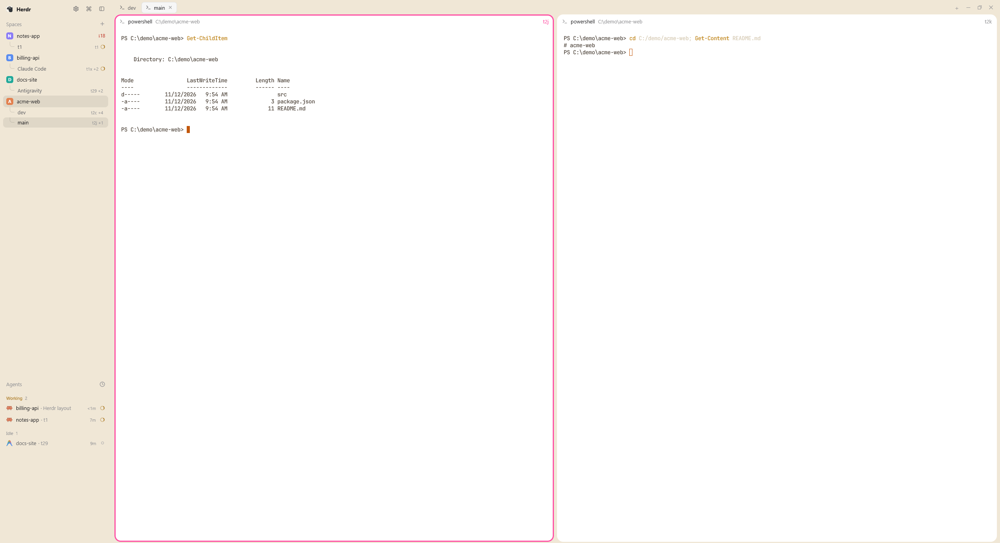

# Seamless

A borderless, cozy layout. No title bar, no divider lines, no status bar: a cream sidebar on the left, a tab strip on top, and the panes as soft rounded cards on a sand background. The focused pane gets a pink ring. Spaces list their tabs as a tree underneath, and each pane shows its terminal address (`t1x`) in the header.

## What you see

Left to right, one window with no title bar (`titlebar: "none"`) and no lines between regions.

- **Sidebar, 268px wide**, background `chrome` (cream `#f0e7d6` in light mode). Not resizable.
  - Header, 46px: the Herdr logo (20px, radius 5) and "Herdr" in semibold, then three 29px icon buttons on the right: Settings (gear), Command palette (the Lucide "command" glyph, stroke 1.5), Sidebar toggle.
  - "Spaces" list: heading "Spaces" at 13px with a "+" button. Each space is a row (avatar, name, git ahead/behind). Under each space, its tabs as a tree with elbow connectors, 26px rows at 13px, the terminal address and "+N" at the right in 11px dim text.
  - "Agents" list below it, heading "Agents" at 13px, no top divider.
  - The footer block is empty.
- **Work area**, background `chrome`.
  - Tab strip, 34px: tabs as 29px-high pills at 13px; the active one has a border and the `raised` color, inactive ones are transparent. A "+" button, then Files and Changes buttons (13px, transparent when off) that toggle a hidden side panel. Window buttons at the right on Windows.
  - Pane area: 3px top/bottom and 8px left/right padding, 8px gap between panes. Each pane is a card with radius 16, fill `background` (white `#ffffff` in light mode), and a 30px header at the top.
- **Pane header**: program icon, program name or terminal title (13px), the folder (dim), the agent status, then the terminal address at the far right. The address is pink `#ff4fa3` on the focused pane and dim otherwise. On hover, split right, split down, zoom and close buttons appear to its right.
- **Theme**: light uses the bundled `cozy-paper` (`themes/cozy-paper.json`): `chrome` `#f0e7d6`, `canvas` `#e5d9c4`, terminal background `#ffffff`, text `#4a4036`. Dark uses the shipped `graphite`.

## How it behaves

- **Agent status**: working shows a spinning 12px icon in the pane header, in the tab pill and in the space's tab row. Blocked shows a "Needs you" badge (13px semibold) in the pane header and a 6px dot on the tab. Done shows a 7px dot in the pane header and a 6px dot on tabs. Idle shows nothing.
- **Focus**: the focused pane has a 3px pink ring. Every pane also has a 3px transparent border, so panes do not shift when focus moves.
- **Tab names**: a tab nobody named shows the agent's name, else its folder name, else the program name, else "Terminal". Display only; the tab stays unnamed.
- **Space tree**: clicking a tab row selects its space, then the tab. When the active tab of the active space is the first tab, the space row and the tab row share one `selected` color and squared touching corners, so they read as one block.
- **Header buttons**: Settings runs `app.settings`, the command icon runs `app.palette` (clicking again closes it), the toggle collapses the sidebar to a rail.
- **Files / Changes**: open the side panel (338px, hidden by default), remembered per space.
- **Terminal address**: the id `hc send` accepts, shown at the far right of each pane header.

## Built from

Layout `layouts/seamless.json`, a copy of the shipped `main` layout with changes:

- Root: `type: "row"`, `titlebar: "none"`, `background: "canvas"`, `terminal_padding: [14, 12]`, `terminal_opacity: 0` (the card's own rounded fill shows through, so the terminal's square fill does not poke past the corners), `theme: { light: "cozy-paper", dark: "graphite" }`. No dividers anywhere.
- `sidebar`: column, 268px, `background: "chrome"`, children `brand` (46px, mod `seamless-chrome`), `sidebar-lists` (`spaces` with mod `seamless-spaces`, `agents` with mod `seamless-agents`, weight 1 each, min 90), `sidebar-footer` (69px, mod `seamless-chrome` with `props: { footer: true }`).
- `work`: column, `background: "chrome"`, children `tabs` (34px, mod `seamless-tabs`) and `work-body` (row, padding `[3, 8]`, gap 8). No status bar.
- `main` block: `content: { tab: "active", pane: { gap: 8, radius: 16, background: "background", lone: true, border: { width: 3, color: "#00000000" }, focus: { width: 3, color: "#ff4fa3" }, header: { content: { mod: "seamless-pane" }, height: 30, position: "top", reveal: "always" } } }`.
- `panel` (hidden, 338px, min 280, max 900) with a `panel-body` stack of `files` and `changes`, which use the shipped `files` and `changes` mods.

The mods are clones of shipped mods (`herdr-app do mod.clone '{"name":"X","as":"seamless-X"}'`), each edited in its `main.js`:

- `seamless-tabs` (from `tabs`): bottom border removed, `.pt(5)`, pill text 13px and height 29, inactive pills and panel buttons transparent (`#00000000`), Files and Changes buttons 13px, unnamed tabs get an automatic name.
- `seamless-spaces` (from `spaces`): "Spaces" heading 13px, no chrome background, a tab subtree under each space (`tabRows`, elbow connectors drawn with `border_l` and `border_b`), the terminal address and "+N" via `addrs`, and the shared active color on the first active tab.
- `seamless-agents` (from `agents`): heading 13px, no chrome background, no top divider.
- `seamless-chrome` (from `workspace-chrome`): header buttons 29px, Settings added before the palette button, the footer renders nothing, backgrounds and footer border removed. Adds `command.svg`.
- `seamless-pane` (from `pane`): header text 13px, header square background and bottom border removed, the terminal address (`p.terminal`) at the far right.

Theme file `themes/cozy-paper.json`: `background #ffffff`, `foreground #4a4036`, `selection #eadfc8`, `cursor #c2570c`, a warm 16-color `ansi`, and `colors: { chrome: "#f0e7d6", canvas: "#e5d9c4" }`.

`herdr` functions used: `spaces`, `panes`, `run`, `theme`, `layout`, `props`, `shared`, `setShared`, `settings`, `window`, `updates`, `openOverlay`, `home`. Commands: `app.settings`, `app.palette`, `space.select`, `tab.select`, `layout.show`, `layout.hide`, `layout.select`, `layout.resize`, `pane.focus`, `pane.split`, `pane.zoom`, `pane.close`. No network, no programs run.

## Watch out

- Do not write the layout or theme with a byte-order mark. Herdr silently rejects a layout that has one. Write with a tool that does not add a BOM.
- `terminal_opacity: 0` is what removes the square terminal fill in the pane corners. Without it the bottom corners of the cards look cut.
- `colors` overrides in a layout apply to both light and dark. That is why the light colors live in a theme file, paired with `graphite` for dark.
- The 3px transparent `border` is deliberate; take it out and the panes jump when focus moves.
- The pink `#ff4fa3` is hard-coded in the layout and in `seamless-pane`, not a theme color.
- Per-appearance values cannot go in a layout; the dark theme is the shipped `graphite`, nothing here adjusts it.
- The collapsed sidebar rail hides the header buttons, so Settings is only reachable from the expanded header.
- Most of the `.svg` files copied into the clones (for example `search.svg` in `seamless-chrome`) are unused leftovers from `mod.clone` and can stay.

## Done when

- `herdr-app check` passes for each of the five mods and `herdr-app status` shows `errors: []`.
- The window has no title bar, no divider lines and no status bar; the sidebar is 268px and cream, the gaps around the cards are sand, the cards are white.
- The sidebar header shows Settings, the command icon and the sidebar toggle; clicking the command icon opens the palette.
- A space with one tab and that tab active shows one rounded block with no seam.
- The focused pane has a pink ring and its address is pink; moving focus does not shift any pane.
- With the system in dark mode the layout shows the `graphite` theme with the same structure.
